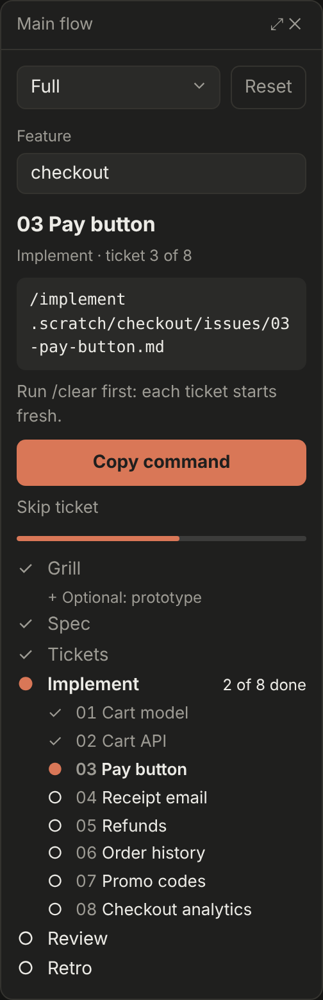
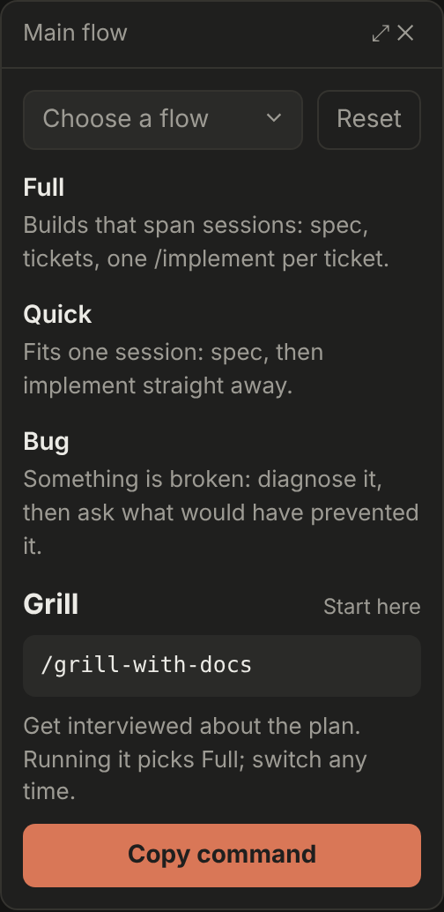
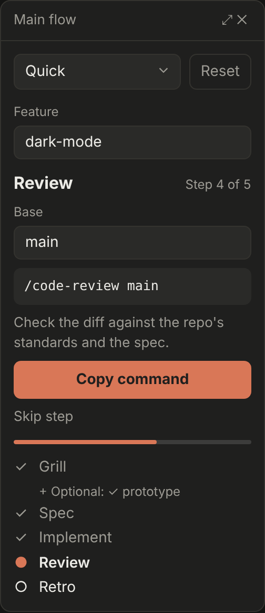
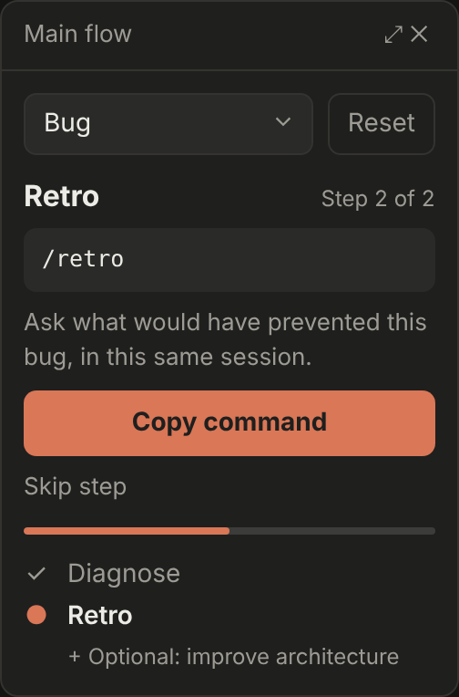
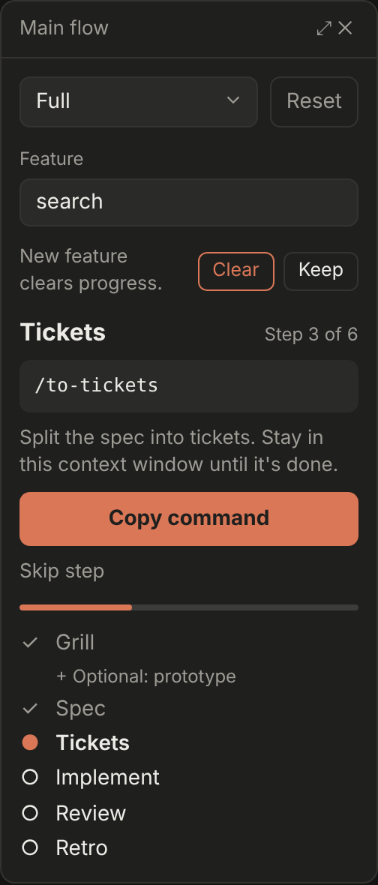
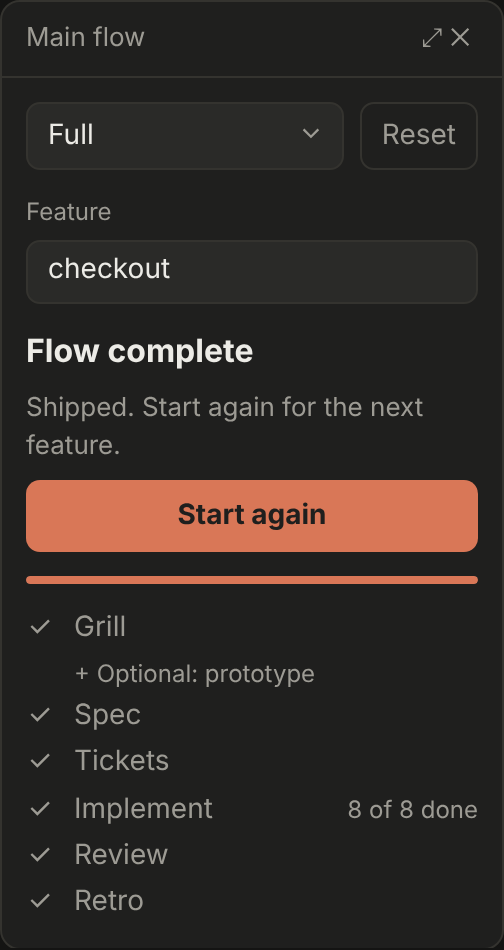

# main-flow

A Claude Code mod that tracks Matt Pocock's idea-to-ship workflow, [the main flow](https://www.aihero.dev/skills), and tells you which command to run next.

Pick a flow, and the mod marks each step as you go, whether you type the slash command or Claude invokes the skill. It suggests the next command with its arguments filled in, follows your tickets one at a time, and keeps your place across `/clear` and new sessions.



## The flows

| Flow | Steps |
| --- | --- |
| Full | grill → (prototype) → spec → tickets → implement, one ticket at a time → review → retro |
| Quick | grill → (prototype) → spec → implement → review → retro |
| Bug | diagnose → retro → (improve architecture) |

- **Full** is for builds that span sessions. **Quick** fits one session. **Bug** is for something broken.
- Running `/grill-with-docs` with no flow chosen picks Full. You can switch flows at any time, and progress is recomputed from what you've run.
- Each step accepts more than one skill name:
  - Grill: `grill-with-docs`, `grill-me` or `grilling`
  - Implement: `implement`, `implement-spec` or `tdd`
  - Plugin-prefixed names such as `mattpocock-skills:grilling` count too.
- **Tickets** come from `.scratch/<feature>/issues/NN-slug.md`:
  - The next ticket is the lowest-numbered one whose `Blocked by:` tickets are done.
  - `/implement <ref>` marks the ticket it names (by number, file name, path or `#NN`). A bare `/implement` marks the next one, and `/implement-spec` marks them all.
- **Review only counts after Implement is complete.** `/implement` runs a code review on every ticket, and those reviews don't move the flow on. The review after the last ticket completes Review.
- **A diagnosis mid-build is a detour.** If Claude runs `diagnosing-bugs` during a Full or Quick build, the pane shows "Diagnosed a bug" and stays where it was.
- **Each hint line carries the flow's context rules:** keep grill through tickets in one window, `/clear` before each ticket, and run `/retro` before you clear.

## Picking up where you are

Installed mid-build, or opened in a resumed session, the pane catches up. It reads:

- the main-flow commands and skill calls already in this session's transcript;
- `.scratch/<feature>/spec.md` (marks Spec done);
- the ticket files (mark Tickets done);
- each ticket's `Status:` line (`resolved` or `done` marks that ticket done).

It only ever adds progress, and a toast says what it picked up. You can also tap any step to mark it and the steps before it done, tap it again to undo, or tap a ticket row to toggle it.

## Two ways it shows

**Pane** (local sessions in the terminal or the desktop app), top to bottom:

- A **flow dropdown** and a **Reset** button.
- A **Feature** field (the `.scratch` folder name, such as `checkout`). It fills itself in when there's only one feature folder. Changing it mid-flow asks before clearing progress.
- The **next step**: its name and "Step 2 of 6", the command, a one-line hint, a **Copy command** button and a quiet **Skip step**.
  - On Implement, the card leads with the ticket ("03 Pay button") and its file.
  - On Review, a **Base** field (default `main`) fills `/code-review <base>`.
- A **progress bar** that fills ticket by ticket during Implement.
- The **step list**: `✓` done, `●` current, `○` to do, `–` skipped. The tickets are listed under Implement while it is current.

A toast says when a step completes. When the flow is done, **Start again** clears progress and keeps the feature. On the mobile app, the dropdown becomes flow buttons and the fields are read-only.

| No flow chosen | Review | Bug flow | New feature | Flow complete |
| --- | --- | --- | --- | --- |
|  |  |  |  |  |

The images are mockups of the pane's layout and wording, rendered from [`docs/mockup/pane.html`](docs/mockup/pane.html). The app draws its own dropdown, fields and buttons, so colours and corners follow your theme.

**Text** (sessions that can't draw a pane, such as cloud sessions): the slash command prints the same information.

```
/main-flow full

Full: checkout

Next: 03 Pay button (implement · ticket 3 of 8)
  /implement .scratch/checkout/issues/03-pay-button.md
  Run /clear first: each ticket starts fresh.

  ✓ Grill
    + Optional: prototype
  ✓ Spec
  ✓ Tickets
  ● Implement  2 of 8 done
      ✓ 01 Cart model
      ✓ 02 Cart API
      ● 03 Pay button
      ○ 04 Receipt email
      …
  ○ Review
  ○ Retro
```

## Commands

| Command | What it does |
| --- | --- |
| `/main-flow` | Open the pane, or print the flow where no pane can be drawn |
| `/main-flow full` | Choose the Full flow |
| `/main-flow quick` | Choose the Quick flow |
| `/main-flow bug` | Choose the Bug flow |
| `/main-flow reset` | Clear the flow, its progress and the feature |

## Settings

If your skills have other names, add them under **aliases** in the plugin's settings, as `step=name` pairs separated by commas:

```
implement=build-it, grill=interview
```

The steps are `grill`, `prototype`, `spec`, `tickets`, `implement`, `review`, `retro`, `diagnose` and `architecture`.

## Install

You need Matt Pocock's skills too: `claude plugin install mattpocock-skills@claude-plugins-official`, then `/setup-matt-pocock-skills` once per repo. Pick the local-markdown tracker so tickets live in `.scratch/`.

At the prompt of a terminal session:

```
/plugin install main-flow --marketplace Nirkusan/main-flow-mod
```

Answer `y` to add the marketplace, then pick a scope.

From a shell:

```
claude plugin install main-flow --marketplace Nirkusan/main-flow-mod
```

In the desktop app, where `/plugin` does not run: click + next to the prompt box, then **Plugins**, **Add marketplace** with `Nirkusan/main-flow-mod`, then **Add plugin**.

Update later with `claude plugin update main-flow`.

## Develop

Load it from a local checkout without installing:

```
claude --plugin-dir /path/to/main-flow-mod
```

For a session the desktop app starts, add this to `~/.claude/settings.json`:

```json
{ "env": { "CLAUDE_CODE_PLUGIN_DIRS": "/path/to/main-flow-mod" } }
```

Edits reload by themselves in a session that loads the folder this way.

Check and test it:

```
claude plugin validate .
claude plugin test .
```

The step logic lives in `hooks/flows.ts`. The pane, the slash command and the hooks that record commands are in `hooks/register.tsx`. The vocabulary is in `CONTEXT.md`, and the spec and tickets the mod was built from are in `.scratch/main-flow/`.
